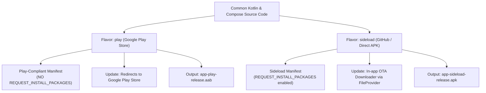

# CiboTimer ⏱️🍽️🔥

<div align="center">


### *Advanced Intermittent Fasting, Nutrition & Metabolic Wellness Tracker*

[🇬🇧 English](README.md) • [🇮🇹 Italiano](README_IT.md)

[-brightgreen.svg?style=for-the-badge&logo=android)](https://www.android.com/)
[-blue.svg?style=for-the-badge&logo=android)](https://developer.android.com/about/versions/14)
[](https://kotlinlang.org/)
[](https://developer.android.com/jetpack/compose)
[](#-dual-channel-distribution-architecture)
[](#-privacy--data-security)
[](https://www.gnu.org/licenses/agpl-3.0)

</div>

---

## 📖 Overview

**CiboTimer** is a native Android application built with **Kotlin** and **Jetpack Compose (Material 3)**, designed for scientific, fluid, and battery-efficient tracking of intermittent fasting and healthy eating windows.

Engineered with a **100% free, ad-free, and privacy-first** philosophy, CiboTimer operates *Offline-First*: all personal data stays strictly on your device, with optional cloud backup to Google Drive or standard JSON export.

---

## ✨ Key Features

### 1. ⏱️ Dynamic Circular Timer with Dual Gradient
- **Immediate Visual Status**:
  - **Eating Window (`🍽️ EATING`)**: Bright cyan badge, countdown indicator for meal periods, and nutritional reminders.
  - **Fasting Window (`🔥 FASTING`)**: Pulsing energy flame, cobalt blue theme, real-time second counting, and metabolic stage tracking.
- **Neon Glow Arc**: Gradient transition from cobalt blue (`#0284C7`) to neon cyan (`#00E5FF`) with a real-time progress glow dot.
- **Smart Adjustments**: Instant editing of start and end times with intelligent schedule shifts.

### 2. 🧬 7 Scientific Metabolic Stages
Biological explanations of your body's biochemical processes throughout the fast:
1. **0h - 4h**: *Digestion & Blood Sugar* (insulin spike and nutrient absorption).
2. **4h - 8h**: *Insulin Drop & Glycogenolysis* (emptying stomach and tapping liver glycogen).
3. **8h - 12h**: *Fat Burning* (activation of lipolysis).
4. **12h - 16h**: *Ketosis* (ketone body production for clean brain fuel).
5. **16h - 24h**: *Autophagy* (cellular cleanup and component recycling).
6. **24h - 48h**: *Growth Hormone (HGH)* (lean muscle protection and tissue regeneration).
7. **48h+**: *Immune System Renewal* (hematopoietic stem cell stimulation).

### 3. 📊 Panoramic 24-Hour Weekly Plan
- **7-column overview (Monday - Sunday)** displaying the entire week at a single glance without scrolling.
- Horizontal time guidelines (0h, 6h, 12h, 18h, 24h).
- **"Today" Highlight**: Cyan neon outline, radiant indicator, and quick-access schedule times.
- Built-in popular presets (16:8, 14:10, 18:6, 20:4, OMAD, Circadian) or completely custom daily schedules.

### 4. 🔔 Zero-Battery Real-Time Notifications
- Persistent notification in the shade and lock screen using Android's hardware chronometer (`setUsesChronometer` / `setChronometerCountDown`) to render live seconds with **zero battery drain**.
- Background Foreground Service optimized and compliant with **Android 14 (API 34)** (`specialUse`).
- Accurate alarms (`SCHEDULE_EXACT_ALARM`) for eating window closure, fast start, and milestone stage alerts.

### 5. 📱 Home Screen Widgets
- **Dynamic 2x1 Widget**: Live fasting progress, percentage, and estimated completion time right on your launcher.
- **One-Tap Widget Button**: Instantly start or conclude eating windows directly from the home screen.

### 6. ⚖️ Body Weight & Measurements Journal
- **Weight & BMI Log**: Chronological weigh-in history, automated Body Mass Index calculation, and anthropometric measurements (waist, hips, chest, thighs).
- **Progress Tracking**: Visual charts showing long-term trends alongside fasting adherence.

### 7. 🤖 Built-in AI Fasting Coach (BYOK)
- Conversational coach compatible with **OpenAI** API specifications and custom endpoints (Ollama, vLLM, LocalLLM).
- **1-Click Plan Import**: The AI generates structured JSON fasting plans tailored to your lifestyle, which you can apply to your schedule with a single tap.

### 8. ☁️ Flexible Backup & Restore
- Full data import/export in standard **JSON** format.
- System share sheet integration to backup to Google Drive ("Save to Drive"), Telegram, WhatsApp, or Email.
- Optional direct cloud synchronization using Google Drive REST API v3.

---

## 🔄 Dual-Channel Distribution Architecture

The codebase leverages **Gradle Product Flavors** to support both official **Google Play Store** distribution and direct **Sideload / GitHub Releases**:



| Dimension | `play` Flavor (Play Store) | `sideload` Flavor (GitHub / Direct) |
| :--- | :--- | :--- |
| **Output Format** | Android App Bundle (`.aab`) | Installable APK file (`.apk`) |
| **`REQUEST_INSTALL_PACKAGES`** | ❌ **Excluded** (Play Policy Compliant) | ✅ **Included** (Self-contained updates) |
| **Update Mechanism** | Opens official **Google Play Store** listing | Downloads APK from DuckDNS/GitHub & prompts install |
| **Primary Channel** | Google Play Store | GitHub Releases / DuckDNS |

---

## 🛠️ Tech Stack & Architecture

- **Language**: Kotlin 2.0.21
- **User Interface**: Jetpack Compose & Material 3 (BOM 2024.09.00)
- **Architecture**: MVVM + Clean Architecture + Offline-First Repository Pattern
- **Asynchrony**: Kotlin Coroutines & StateFlow / SharedFlow
- **Networking**: OkHttp 4.12.0
- **Serialization**: Kotlinx Serialization JSON 1.6.3
- **Background Work**: Foreground Service (`specialUse`), AlarmManager, BroadcastReceiver
- **Android Target**: minSdk 26 (Android 8.0 Oreo), targetSdk 34 (Android 14)
- **Build System**: Gradle 8.5.2 (Kotlin DSL `.kts`)

---

## 📂 Project Structure

```
cibotimer/
├── app/
│   ├── build.gradle.kts                 # Build config, target SDK 34, play & sideload flavors
│   └── src/
│       ├── main/
│       │   ├── AndroidManifest.xml      # Base manifest strictly compliant with Google Play
│       │   ├── java/com/cibotimer/
│       │   │   ├── CiboTimerApp.kt      # Application initialization
│       │   │   ├── MainActivity.kt      # Root Compose activity
│       │   │   ├── data/                # Models, repository, Google Drive and AI clients
│       │   │   ├── domain/              # Fasting calculator, stages, and plan engines
│       │   │   ├── notifications/       # FastingTimerService, NotificationHelper, Alarms
│       │   │   ├── update/              # Multi-channel UpdateManager
│       │   │   ├── widget/              # AppWidget providers and action receivers
│       │   │   └── ui/                  # Themes, screens, and Compose components
│       │   └── res/                     # Strings (en, it), drawables, layouts, widget configs
│       ├── sideload/
│       │   └── AndroidManifest.xml      # Sideload-only permissions (package installer)
│       └── test/                        # Unit tests (calculators, JSON parser, plans)
├── docs/                                # Documentation, diagrams, and UI screenshots
├── git_exclude/                         # Local resources excluded from Git (Play Store guides, keys)
├── README.md                            # English documentation (default)
├── README_IT.md                         # Italian documentation
├── gradlew                              # Gradle wrapper for Linux/macOS
├── gradlew.bat                          # Gradle wrapper for Windows
├── build.gradle.kts                     # Root build file
└── settings.gradle.kts                  # Gradle settings
```

---

## 🚀 Building & Running

### Prerequisites
- **Android Studio** (Koala / Ladybug or newer)
- **JDK 17 or JDK 21**
- **Android SDK Platform 34**

### 1. Build for Google Play Store (AAB)
To generate the signed Android App Bundle ready for Google Play Console upload:
```bash
./gradlew bundlePlayRelease
```
The output artifact is generated at:
`app/build/outputs/bundle/playRelease/app-play-release.aab`

### 2. Build for Sideload / GitHub Releases (APK)
To generate the standalone APK with built-in OTA updates:
```bash
./gradlew assembleSideloadRelease
```
The output artifact is generated at:
`app/build/outputs/apk/sideload/release/app-sideload-release.apk`

### 3. Run Unit Tests
```bash
./gradlew test
```

---

## 🔐 Signing & Keystore Configuration

To protect secrets, signing keystores (`*.keystore`, `*.jks`) and credential files (`keystore.properties`) are strictly **ignored by Git** via `.gitignore`.

You can configure signing credentials locally:

1. **Environment Variables** (recommended for CI/CD GitHub Actions):
   ```bash
   export KEYSTORE_PASSWORD="your_keystore_password"
   export KEY_ALIAS="your_alias"
   export KEY_PASSWORD="your_key_password"
   ```
2. **Local `keystore.properties`**:
   Copy the template from `git_exclude/keystore.properties.example` to the project root:
   ```properties
   KEYSTORE_PATH=keystore/cibotimer.keystore
   KEYSTORE_PASSWORD=your_password
   KEY_ALIAS=your_alias
   KEY_PASSWORD=your_password
   ```

---

## 🛡️ Privacy & Data Security

- **No Trackers**: No third-party ad networks (Google AdMob, Unity, AppLovin) or intrusive tracking SDKs.
- **On-Device Storage**: Fasting logs, body weight, anthropometric measurements, and personal notes are kept locally on device storage.
- **Encrypted Networking**: All network requests (Google Drive, OpenAI, DuckDNS) strictly use encrypted **HTTPS/TLS**.
- **User Control**: You can export or permanently delete all your data at any time from the Settings screen.

---

## ⚠️ Health & Medical Disclaimer

> **IMPORTANT**: CiboTimer is developed solely for educational, informational, and general wellness tracking purposes. It is not a medical device and does not provide clinical medical advice, diagnosis, or nutritional prescriptions. Intermittent fasting is not suitable for everyone (e.g. during pregnancy, breastfeeding, type 1 diabetes, eating disorders, or chronic medical conditions). Always consult your qualified healthcare professional before beginning any fasting routine or major dietary alteration.

---

## 📄 License

This project is licensed under the terms of the GNU Affero General Public License v3 (AGPL-3.0). See [LICENSE](LICENSE) for details.
