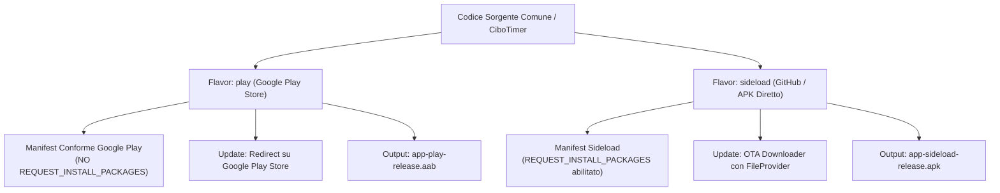

# CiboTimer ⏱️🍽️🔥

<div align="center">


### *Monitoraggio Avanzato del Digiuno Intermittente, Nutrizione e Benessere Metabolico*

[🇮🇹 Italiano](README_IT.md) • [🇬🇧 English](README.md)

[-brightgreen.svg?style=for-the-badge&logo=android)](https://www.android.com/)
[-blue.svg?style=for-the-badge&logo=android)](https://developer.android.com/about/versions/14)
[](https://kotlinlang.org/)
[](https://developer.android.com/jetpack/compose)
[](#-architettura-di-distribuzione-a-doppio-canale)
[](#-privacy--sicurezza-dei-dati)
[](https://www.gnu.org/licenses/agpl-3.0)

</div>

---

## 📖 Panoramica del Progetto

**CiboTimer** è un'applicazione Android nativa di ultima generazione realizzata con **Kotlin** e **Jetpack Compose (Material 3)**, progettata per offrire un tracciamento scientifico, fluido ed elegante del digiuno intermittente e delle abitudini alimentari.

Nata con la filosofia **100% libera, senza annunci pubblicitari e rispettosa della privacy**, CiboTimer opera in modalità *Offline-First*: tutti i tuoi dati rimangono custoditi localmente sul tuo smartphone, con possibilità facoltativa di backup su Google Drive o esportazione JSON standard.

---

## ✨ Funzionalità Chiave

### 1. ⏱️ Timer Circolare Dinamico a Doppio Gradiente
- **Distinzione Visiva Immediata**:
  - **Finestra Pasto (`🍽️ MANGIARE`)**: Badge azzurro ciano luminoso, indicatore visivo del tempo rimasto per consumare i pasti e promemoria nutrizionali.
  - **Finestra di Digiuno (`🔥 DIGIUNARE`)**: Fiamma pulsante, tonalità blu cobalto elettrico, conteggio in tempo reale dei secondi e tracciamento continuo della fase biologica.
- **Arco Circolare Fluorescente**: Sfumatura dal blu cobalto (`#0284C7`) all'azzurro ciano neon (`#00E5FF`) con indicatore luminoso (*glow dot*) che segue il progresso in tempo reale.
- **Regolazione Ergonomica**: Modifica rapida degli orari di inizio e fine sessione con traslazione intelligente degli orari giornalieri.

### 2. 🧬 7 Fasi Metaboliche e Biologiche
Spiegazione scientifica e approfondita dei processi biochimici attivi durante il digiuno:
1. **0h - 4h**: *Digestione & Assorbimento* (glicemia e picco insulinico).
2. **4h - 8h**: *Calo dell'Insulina & Glicogenolisi* (attivazione delle riserve epatiche).
3. **8h - 12h**: *Combustione dei Grassi* (avvio della lipolisi).
4. **12h - 16h**: *Chetosi Naturale* (produzione di corpi chetonici per energia cerebrale).
5. **16h - 24h**: *Autofagia Cellulare* (riciclo delle componenti cellulari usurate).
6. **24h - 48h**: *Ormone della Crescita (GH)* (protezione della massa magra e densità ossea).
7. **48h+**: *Rigenerazione del Sistema Immunitario* (stimolazione delle cellule staminali).

### 3. 📊 Grafico Settimanale 24 Ore ("Piano Digiuno")
- Visualizzazione panoramica a **7 colonne (Lunedì - Domenica)** visualizzabile a colpo d'occhio senza necessità di scorrimento.
- Riferimento orizzontale a fasce orarie (0h, 6h, 12h, 18h, 24h).
- **Evidenziazione "Oggi"** con contorno neon ciano, badge radioso e orari di apertura e chiusura finestra.
- Piani preimpostati (16:8, 14:10, 18:6, 20:4, OMAD, Digiuno Circadiano) o personalizzati per ogni giorno.

### 4. 🔔 Notifiche Real-Time & Foreground Service a Basso Consumo
- Notifica continua nella tendina e nella lockscreen con cronometro hardware integrato (`setUsesChronometer` / `setChronometerCountDown`) per visualizzare i secondi in tempo reale a **impatto batteria nullo**.
- Servizio di sistema in foreground ottimizzato conforme ai requisiti **Android 14 (API 34)**.
- Avvisi e sveglie precise (`SCHEDULE_EXACT_ALARM`) per la chiusura della finestra pasto, inizio digiuno e passaggio tra fasi metaboliche.

### 5. 📱 Widget per la Schermata Home
- **Widget 2x1 Dinamico**: Stato attivo del digiuno, percentuale completata e orario stimato di conclusione direttamente sul launcher.
- **Pulsante One-Tap sul Widget**: Avvia o termina la finestra di alimentazione istantaneamente senza dover aprire l'applicazione.

### 6. ⚖️ Diario del Peso & Misure Corporee
- **Diario Peso & BMI**: Storico cronologico delle pesate, calcolo automatico del Body Mass Index, stato corporeo e misurazioni antropometriche (vita, fianchi, torace, cosce).
- **Monitoraggio dei Progressi**: Grafici visivi sull'andamento nel tempo e traguardi raggiunti parallelamente ai ritmi di digiuno.

### 7. 🤖 Coach Nutrizionale AI Integrato (BYOK)
- Chatbot motivazionale compatibile con le API **OpenAI** e qualsiasi endpoint compatibile (LocalLLM, Ollama, vLLM).
- **Generazione Piani Intelligente**: L'AI può generare piani di digiuno personalizzati in formato JSON strutturato, applicabili direttamente al pianificatore dell'app con 1 solo tocco.

### 8. ☁️ Backup & Ripristino Flessibile
- Esportazione ed importazione completa in formato **JSON**.
- Condivisione sicura tramite il menu nativo di Android verso Google Drive ("Salva su Drive"), Telegram, WhatsApp o Email.
- Sincronizzazione cloud opzionale con le Google Drive REST API v3.

---

## 🔄 Architettura di Distribuzione a Doppio Canale

Il progetto adotta un'architettura basata su **Gradle Product Flavors** per supportare sia la distribuzione ufficiale sul **Google Play Store**, sia la distribuzione diretta (**Sideload / GitHub Releases**):



| Funzionalità | Flavor `play` (Play Store) | Flavor `sideload` (GitHub / Standalone) |
| :--- | :--- | :--- |
| **Formato Output** | Android App Bundle (`.aab`) | File APK installabile (`.apk`) |
| **`REQUEST_INSTALL_PACKAGES`** | ❌ **Escluso** (Conformità Policy Google Play) | ✅ **Abilitato** (per installazione autonoma) |
| **Gestione Aggiornamenti** | Apre la scheda su **Google Play Store** | Scarica l'APK da DuckDNS/GitHub e apre l'installer |
| **Canale di Distribuzione** | Google Play Store | GitHub Releases / DuckDNS |

---

## 🛠️ Stack Tecnologico

- **Linguaggio**: Kotlin 2.0.21
- **Interfaccia Grafica**: Jetpack Compose & Material 3 (BOM 2024.09.00)
- **Architettura**: MVVM + Clean Architecture + Offline-First Repository Pattern
- **Asincronia**: Kotlin Coroutines & StateFlow / SharedFlow
- **Rete & HTTP**: OkHttp 4.12.0
- **Serializzazione**: Kotlinx Serialization JSON 1.6.3
- **Background Tasks**: Foreground Service (`specialUse`), AlarmManager, BroadcastReceiver
- **Android Target**: minSdk 26 (Android 8.0 Oreo), targetSdk 34 (Android 14)
- **Build Tool**: Gradle 8.5.2 (Kotlin DSL `.kts`)

---

## 📂 Struttura del Progetto

```
cibotimer/
├── app/
│   ├── build.gradle.kts                 # Configurazione build, target SDK 34, flavors play/sideload
│   └── src/
│       ├── main/
│       │   ├── AndroidManifest.xml      # Manifest principale conforme a Google Play
│       │   ├── java/com/cibotimer/
│       │   │   ├── CiboTimerApp.kt      # Application class e inizializzazione
│       │   │   ├── MainActivity.kt      # Activity principale Compose
│       │   │   ├── data/                # Modelli, repository e client remoti (Drive, OpenAI)
│       │   │   ├── domain/              # Calcolatori biologici, BMI, piani e orari
│       │   │   ├── notifications/       # FastingTimerService, NotificationHelper, Allarmi
│       │   │   ├── update/              # UpdateManager (multi-canale Play / OTA)
│       │   │   ├── widget/              # AppWidgetProvider e ricevitori azioni widget
│       │   │   └── ui/                  # Temi, schermate e componenti Compose
│       │   └── res/                     # Layout widget, icone vettoriali, stringhe, colori
│       ├── sideload/
│       │   └── AndroidManifest.xml      # Permessi extra per auto-update esterno
│       └── test/                        # Suite di unit test (calcolatori, parser JSON, piani)
├── docs/                                # Documentazione, schemi e screenshot
├── git_exclude/                         # Risorse locali escluse da Git (guide Play Store, privacy, chiavi)
├── gradlew                              # Gradle wrapper per Linux/macOS
├── gradlew.bat                          # Gradle wrapper per Windows
├── build.gradle.kts                     # Gradle root
└── settings.gradle.kts                  # Configurazione moduli Gradle
```

---

## 🚀 Compilazione e Avvio

### Prerequisiti
- **Android Studio** (Koala / Ladybug o versioni più recenti)
- **JDK 17 o JDK 21**
- **Android SDK Platform 34**

### 1. Compilazione per il Google Play Store (AAB)
Per generare l'Android App Bundle firmato e conforme al 100% per la Google Play Console:
```bash
./gradlew bundlePlayRelease
```
L'artefatto generato si troverà in:
`app/build/outputs/bundle/playRelease/app-play-release.aab`

### 2. Compilazione per Distribuzione Sideload / GitHub (APK)
Per generare l'APK con funzionalità completa di auto-aggiornamento via OTA DuckDNS/GitHub:
```bash
./gradlew assembleSideloadRelease
```
L'artefatto generato si troverà in:
`app/build/outputs/apk/sideload/release/app-sideload-release.apk`

### 3. Esecuzione dei Test Unitari
```bash
./gradlew test
```

---

## 🔐 Firma e Configurazione Keystore

Per garantire la massima sicurezza, i file di firma (`*.keystore`, `*.jks`) e i file di configurazione con credenziali (`keystore.properties`) sono protetti e **ignorati da Git** tramite `.gitignore`.

Puoi configurare la firma in locale in due modi:

1. **Variabili d'ambiente** (ideale per CI/CD GitHub Actions):
   ```bash
   export KEYSTORE_PASSWORD="tua_password_keystore"
   export KEY_ALIAS="tuo_alias"
   export KEY_PASSWORD="tua_password_chiave"
   ```
2. **File locale `keystore.properties`**:
   Copia il modello presente in `git_exclude/keystore.properties.example` nella root del progetto:
   ```properties
   KEYSTORE_PATH=keystore/cibotimer.keystore
   KEYSTORE_PASSWORD=tua_password
   KEY_ALIAS=tuo_alias
   KEY_PASSWORD=tua_password
   ```

---

## 🛡️ Privacy & Sicurezza dei Dati

- **Nessun tracciamento**: L'app non include SDK pubblicitari (Google AdMob, Unity, AppLovin) né librerie di analisi invasiva.
- **Dati sul dispositivo**: Sessioni di digiuno, peso, misurazioni antropometriche e note personali sono memorizzati nello storage protetto dell'app.
- **Comunicazioni Cifrate**: Qualsiasi connessione di rete opzionale (Google Drive, OpenAI, DuckDNS) avviene esclusivamente su protocollo crittografato **HTTPS/TLS**.
- **Controllo Utente**: È possibile esportare tutti i dati o cancellarli completamente in qualsiasi momento con un tocco.

---

## ⚠️ Avvertenza & Disclaimer Medico

> **IMPORTANTE**: CiboTimer è un'applicazione software sviluppata unicamente a scopo informativo, educativo e di supporto al benessere personale. Non è un dispositivo medico e non fornisce consulenza medica, diagnosi, prognosi o prescrizioni dietetico-terapeutiche. Il digiuno intermittente non è adatto a tutti (ad esempio durante la gravidanza, l'allattamento, in presenza di diabete di tipo 1, disturbi del comportamento alimentare o patologie croniche). Consulta sempre il tuo medico curante o uno specialista abilitato prima di intraprendere regimi di digiuno o variazioni significative del tuo stile alimentare.

---

## 📄 Licenza

Questo progetto è rilasciato sotto licenza GNU Affero General Public License v3 (AGPL-3.0). Consulta il file [LICENSE](LICENSE) per maggiori informazioni.
